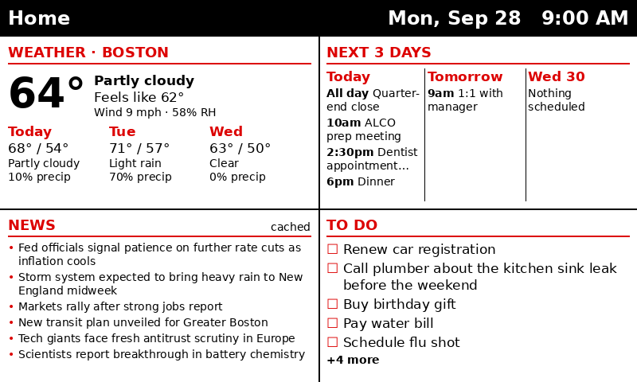

# pi_household_dashboard

A calm, glanceable e-ink home dashboard for the Raspberry Pi and Pimoroni Inky screens.
Weather, your next three days of calendar, top news headlines, and your to-do list,
with the date and time in the corner. It refreshes every hour and needs no subscription.



<a href="https://buymeacoffee.com/breyeslo" target="_blank"></a>

If this saved you a weekend of tinkering, a coffee is always appreciated. ☕

## Features

- **Weather** from [Open-Meteo](https://open-meteo.com): current conditions plus a 3-day forecast. Free, no API key.
- **Calendar**: the next 3 days, from any calendar's iCal link (Google, Outlook, iCloud, and more) or the Google Calendar API.
- **News**: top headlines from any RSS feeds you choose.
- **To-do**: Google Tasks (official API) or a Google Keep note (unofficial).
- **Resilient**: if a source fails, that panel shows the last good copy marked "cached" instead of going blank.
- **Private**: everything runs on your Pi. No accounts with us, no cloud service, no tracking.
- **Fits your screen**: detects the Inky model and scales the layout automatically.

## Hardware

| Part | Notes |
|---|---|
| Raspberry Pi Zero 2 W | Any Pi with a 40-pin header and Wi-Fi works |
| Pimoroni **Inky Impression** (7.3", 5.7", 13.3") or **Inky wHAT** | Tested on the 7.3" Spectra 6. The tiny Inky pHAT is too small for this layout |
| microSD card (8 GB+) and a USB power supply | |

## Quick start

**1. Flash the SD card.** In [Raspberry Pi Imager](https://www.raspberrypi.com/software/), choose
Raspberry Pi OS Lite (64-bit). Under "Edit settings," set a username and password, your Wi-Fi,
your time zone, and enable SSH.

**2. Download this project** (green **Code** button → **Download ZIP**) and unzip it.

**3. Create your config.** Copy `config.example.yaml` to `config.yaml` and edit it:
- `location`: your city name, latitude, and longitude.
- `calendar.ical_urls`: paste your calendar's **secret iCal link**. In Google Calendar:
  Settings → click your calendar → *Integrate calendar* → *Secret address in iCal format*.
  Add as many calendars as you like. Keep this link private; anyone with it can see your events.
- `news.feeds`: any RSS feeds.
- `todo`: see [To-do list options](#to-do-list-options). Or set `enabled: false` to skip it for now.

**4. Copy the folder to the SD card.** With the card in your computer, copy the whole
`pi_household_dashboard` folder onto the **bootfs** drive.

**5. Install on the Pi.** Put the card in the Pi, attach the screen, power it on, and connect
from your computer:

```bash
ssh youruser@yourpi.local
bash /boot/firmware/pi_household_dashboard/install.sh
sudo reboot
```

About two minutes after the reboot the screen draws for the first time, then again at the top of every hour.
Afterwards, delete the copy on the boot drive, since it contains your private links:
`sudo rm -r /boot/firmware/pi_household_dashboard`

## To-do list options

| Option | Setup | Reliability |
|---|---|---|
| **Google Tasks** (`source: tasks`) | One-time Google Cloud setup: see [docs/google-setup.md](docs/google-setup.md) | Official API, stable |
| **Google Keep** (`source: keep`) | Run `keep_token.py` on your computer and paste the token into the config | Unofficial; may break when Google changes things |

The Google Cloud setup also lets you use `calendar.source: google` instead of iCal links if you prefer.

## Preview on your computer

You can design your layout before touching the Pi:

```bash
pip install -r requirements.txt
python dashboard.py --preview test.png            # 800x480 (7.3" Impression)
python dashboard.py --preview test.png --size 600x448
```

## Handy commands (on the Pi)

| | |
|---|---|
| Refresh now | `~/pi_household_dashboard/.venv/bin/python ~/pi_household_dashboard/dashboard.py` |
| Logs | `journalctl -u pi_household_dashboard.service -n 50 --no-pager` |
| Next scheduled run | `systemctl list-timers pi_household_dashboard.timer` |
| Last image drawn | `~/pi_household_dashboard/last.png` |
| Change refresh interval | Edit `OnCalendar=` in `/etc/systemd/system/pi_household_dashboard.timer`, then `sudo systemctl daemon-reload && sudo systemctl restart pi_household_dashboard.timer` |

## Troubleshooting

- **`No module named 'inky'`**: run `~/pi_household_dashboard/.venv/bin/pip install "inky[rpi]>=2.0"`.
- **"Chip Select ... claimed by spi0 CS0"**: make sure `dtoverlay=spi0-0cs` is in
  `/boot/firmware/config.txt` (the installer adds it), then reboot.
- **"No EEPROM detected"**: the screen isn't fully seated on the pins, or I2C is off. Re-run the installer and reboot.
- **SSH says "REMOTE HOST IDENTIFICATION HAS CHANGED"** after re-flashing: run `ssh-keygen -R <pi-address>` on your computer and connect again.
- **A panel says "cached"**: that source failed this hour. Check the logs.
- **Calendar stops after 7 days (Google API only)**: your Google Cloud app is still in Testing mode. See [docs/google-setup.md](docs/google-setup.md), or switch to `source: ical`.

## Contributing

Issues and pull requests are welcome, especially new panel ideas, layouts for other Inky sizes,
and translations. If you would rather say thanks another way, you can [buy me a coffee](https://buymeacoffee.com/breyeslo).

## License

[MIT](LICENSE) © 2026 Barbara Reyes. Not affiliated with Pimoroni, Raspberry Pi, or Google.
